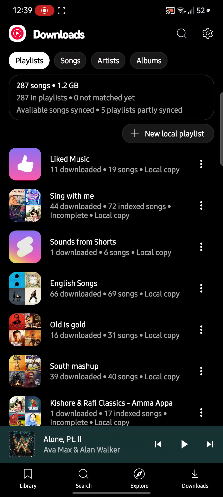
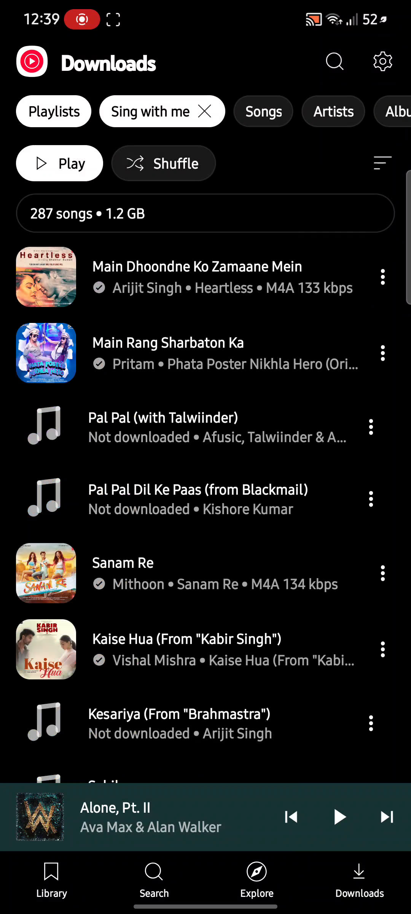
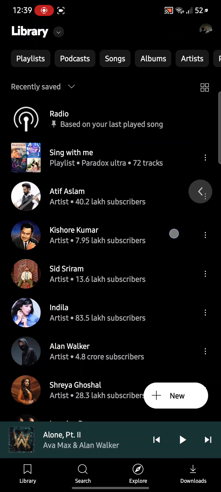

# YT Music Ultra

  

Customized YouTube Music for Android with a built-in MP3 downloader and a native Downloads experience. Library, Search, Explore and Downloads sit in the bottom bar. Installs separately next to the stock app.

## Screenshots

  
  
  

## Features

- Download any song from the song menu, or a whole playlist with Download all
- Highest-quality audio, encoded to MP3
- Downloads screen in the bottom bar with Playlists, Songs, Artists and Albums
- Downloaded songs filed under your Library playlists with the same names and order
- Already-downloaded songs detected automatically, unmatched songs matched by name
- Radio on top of Library, then Liked music
- Shuffle play in place of Share on playlists
- Pin and unpin playlists from the three-dot menu
- Select mode with actions in Library and Downloads
- Cover art for downloaded songs
- Copy or move songs between local playlists
- Optional voice recordings in Downloads
- No Premium upsell in the download flow
- Native YouTube Music look throughout

## Download

Use the latest release: https://github.com/Paradox-ultra/YT-Music-Ultra/releases/latest

- `YT-Music-Ultra.apk` for arm64 phones
- `YT-Music-Ultra-armeabi-v7a.apk` for older 32-bit phones

Package: `app.rvx.android.apps.youtube.musiy`. App name: **YT Music Ultra**. Installs separately; it does not replace YouTube Music or Music Ultra.

## Build from source

This repository holds the downloader module source, tests, audit and packaging scripts, the Android API reference JAR and the host reference JAR.

Prerequisites: Java 17, Maven, Android Build Tools 35.0.0, Android API 33 `android.jar`. Extract `classes.jar` from `androidx.test:monitor:1.7.2` and `androidx.tracing:tracing:1.1.0` AARs and install them as local Maven JARs.

1. Run `colab-QA.py` to compile and execute the test suite (169 tests).
2. Zip freshly compiled `target/classes` into `module.jar`, then run D8 with min-api 26.
3. Package with `package32.py`, which expects `MUSIC_BASE_ARM64`, `MUSIC_BASE_V7A`, `MUSIC_ZIPALIGN`, `MUSIC_APKSIGNER_JAR`, `MUSIC_SIGNING_KEY` and `MUSIC_SIGNING_CERT` in the environment.

Signing keys are deliberately excluded from this repository. Only the manifest and the downloader dex change against the base app; resources, assets and native libraries come from the base APK.

## Change history

The 32 commits in this repository reconstruct the development stages of the app from preserved source snapshots. Each commit corresponds to one internal build, from the first downloader integration to the latest Library fix. They are reconstructed commits, not the original editing timestamps.

## Credits

- Built on ReVanced Extended YouTube Music (inotia00 and contributors)
- Downloader pipeline modeled on LastWave
- Polish pass informed by Unslop (CC BY 4.0) and Magic UI (MIT); see `THIRD-PARTY-UI-NOTICES/`

## License

GPL-3.0. See `LICENSE`.

This project is not affiliated with Google or YouTube. YouTube Music is a trademark of Google LLC.
